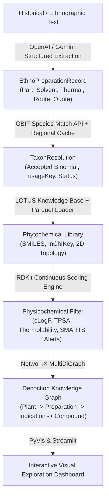

# 🌿 DecoctionGraph

> **Preparation-Aware Ethnobotanical Knowledge Mining & Cheminformatics Filtering**  
> *Gentiana Labs | EthnoHack 2026 (Track 1)*

[](#testing)
[](#installation)
[](LICENSE)

DecoctionGraph is a domain-specific literature extraction and cheminformatics pipeline that treats traditional plant preparation methods—such as prolonged aqueous boiling, cold oil maceration, or hydroalcoholic tinctures—as **analytical chemical extraction filters**. By coupling large language models (LLMs) with taxonomic resolution (GBIF), natural product databases (LOTUS), and physicochemical property modeling (RDKit), DecoctionGraph reconstructs multipartite knowledge graphs that elucidate which bioactives are plausibly solubilized into historical remedies while flagging hazardous toxic scaffolds.

---

## 🏛️ Architecture Overview

The pipeline operates across four interconnected tiers:



1. **Extraction Tier (`src/extraction.py`)**: Uses LLM structured outputs (`client.beta.chat.completions.parse`) with strict atomicity and zero-hallucination quote verification.
2. **Taxonomic Tier (`src/taxonomy.py`)**: Interrogates the GBIF Species Backbone API (`/v1/species/match`) with a persistent local cache and regional vernacular synonym dictionaries.
3. **Cheminformatics Tier (`src/cheminformatics.py`)**: Computes Wildman-Crippen cLogP, TPSA, and molecular weight; flags volatile species and thermolabile endoperoxides; flags toxic structural alerts (pyrrolizidine alkaloids, aristolochic acids, illudanes); and scores extraction plausibility through continuous sigmoidal penalization.
4. **Metabolite Retrieval Tier (`src/lotus_retriever.py`)**: Maps resolved botanical taxa to secondary metabolites from the LOTUS dataset, supporting both offline benchmark profiles and streaming Parquet/CSV subsets.
5. **Knowledge Graph Tier (`src/graph_builder.py`)**: Synthesizes the pipeline into a NetworkX `MultiDiGraph` with dynamic pruning (`get_filtered_subgraph`), node-link JSON export, and PyVis HTML rendering.
6. **Frontend & Interactive UI (`app/main.py`)**: A Streamlit dashboard supporting preloaded case studies, real-time chemical comparison plots (cLogP vs. TPSA), interactive knowledge graph visualization, and CSV export.

---

## 🚀 Quickstart

### Installation

Clone the repository and install dependencies using `pip` or `uv`:

```bash
# Using pip
pip install -r requirements.txt

# Or using uv
uv venv .venv
uv pip install -r requirements.txt
```

### Environment Configuration

To enable live LLM extraction of historical texts, configure your environment variables:

```bash
cp .env.example .env  # or create .env
```

```env
LLM_API_KEY=your_openai_or_gemini_api_key
LLM_MODEL=gpt-4o-mini
# Optional custom base URL (e.g. Groq, OpenRouter, Ollama, vLLM)
# LLM_BASE_URL=https://api.groq.com/openai/v1
```

*(Note: When no API key is provided, the dashboard falls back automatically to offline benchmark case studies and keyword extraction.)*

---

## 🖥️ Running the Application

### 1. Interactive Streamlit Dashboard

Launch the web interface locally:

```bash
streamlit run app/main.py
```

The application provides:
- **Case Study Selector**: Benchmark evaluations for *Hypericum perforatum*, *Gentiana lutea*, *Artemisia annua*, and *Symphytum officinale*.
- **Continuous Plausibility Slider**: Dynamically adjust solvent plausibility thresholds ($0.0 \le s \le 1.0$) to filter out insoluble or degraded compounds.
- **Toxicity Alert Warnings**: Automated SMARTS screening for hepatotoxic pyrrolizidine alkaloids and nephrotoxins.
- **Side-by-Side Preparation Comparison**: Scatter plots of cLogP vs. TPSA sized by molecular weight across comparative preparation regimes.
- **Interactive Knowledge Graph**: Integrated PyVis network viewer with physics simulation.

### 2. Figma Make / Code Layers Deployment

This project is pre-configured for Figma Make and Code Layers:
- **Dev Server**: `.figma/make/dev` starts the Streamlit server in headless mode.
- **Install Script**: `.figma/make/install` boots the Python virtual environment with `uv`.
- **Deploy & Preview**: `.figma/make/deploy` and `.figma/make/deploy-preview` package the static knowledge graph visualization into `dist/`.

### 3. Command Line Testing & Processing

Execute individual modules directly:

```bash
# Test GBIF taxonomic resolution
python -m src.taxonomy

# Test RDKit cheminformatics filters & SMARTS alerts
python -m src.cheminformatics

# Test LOTUS secondary metabolite retrieval
python -m src.lotus_retriever

# Build and export sample knowledge graph
python -m src.graph_builder
```

---

## 🧪 Testing

DecoctionGraph is thoroughly tested with 52 automated test cases covering schemas, taxonomy, cheminformatics, retrieval, extraction, graph topology, and dashboard components:

```bash
python -m pytest tests -v
```

```
============================= 52 passed in 12.76s =============================
```

---

## 📂 Project Structure

```
DecoctionGraph/
├── .figma/                     # Figma Make & Code Layers deployment scripts
│   ├── make/                   # Lifecycle hooks (dev, install, deploy, site.json)
│   └── README.md
├── app/
│   └── main.py                 # Streamlit web dashboard
├── data/
│   ├── processed/              # Cached taxonomies and generated graph artifacts
│   └── reference/              # Curated offline LOTUS secondary metabolite benchmark
├── lib/                        # Offline visualization libraries (vis-network, bindings)
├── src/
│   ├── __init__.py             # Module exports
│   ├── cheminformatics.py      # RDKit descriptor & sigmoidal plausibility engine
│   ├── extraction.py           # LLM structured output literature parser
│   ├── graph_builder.py        # NetworkX & PyVis knowledge graph synthesizer
│   ├── lotus_retriever.py      # LOTUS natural product mapping & enrichment
│   ├── schemas.py              # Strict Pydantic v2 domain models & JSON schemas
│   └── taxonomy.py             # GBIF Species Backbone API client & caching
├── tests/
│   ├── test_app.py             # Streamlit helper & case study unit tests
│   ├── test_cheminformatics.py # RDKit descriptors & toxicity SMARTS tests
│   ├── test_extraction.py      # Structured extraction & fallback tests
│   ├── test_graph_builder.py   # MultiDiGraph & pruning tests
│   ├── test_lotus_retriever.py # LOTUS offline/streaming dataset tests
│   ├── test_schemas.py         # Pydantic schema validation tests
│   └── test_taxonomy.py        # GBIF resolution & fallback cache tests
├── .gitattributes              # Git LFS rules for large/binary assets
├── .gitignore                  # Exclusion rules for virtualenvs, caches & Figma state
├── .mise.toml                  # Tool version definitions (Python 3.12, uv)
├── LICENSE                     # MIT License
├── requirements.txt            # Python dependencies
└── README.md                   # Project documentation
```

---

## ⚖️ License & Disclaimer

- **License**: MIT License. See [LICENSE](LICENSE) for details.
- **Disclaimer**: *DecoctionGraph is a computational research and hypothesis-generation prototype for EthnoHack 2026. Outputs reflect automated text mining and first-order physicochemical estimations, not clinical advice or pharmacological validation.*

