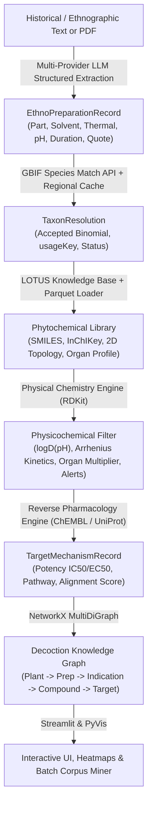

# 🌿 DecoctionGraph

> **Preparation-Aware Ethnobotanical Knowledge Mining & Cheminformatics Filtering**  
> *Gentiana Labs | EthnoHack 2026 (Track 1)*

[](#testing)
[](#installation)
[](LICENSE)

DecoctionGraph is a domain-specific literature extraction and cheminformatics pipeline that treats traditional plant preparation methods—such as prolonged aqueous boiling, cold oil maceration, or hydroalcoholic tinctures—as **analytical chemical extraction filters**. By coupling large language models (LLMs) with taxonomic resolution (GBIF), natural product databases (LOTUS), and physical chemistry modeling (RDKit), DecoctionGraph reconstructs multipartite knowledge graphs that elucidate which bioactives are plausibly solubilized into historical remedies while flagging hazardous toxic scaffolds and mapping plausible mechanisms of action to human macromolecular targets.

---

## 🏛️ Architecture Overview

The pipeline operates across interconnected scientific and computational tiers:



1. **Extraction Tier (`src/extraction.py`)**: Uses multi-provider LLM structured outputs (`client.beta.chat.completions.parse`) with strict atomicity and zero-hallucination quote verification.
2. **Taxonomic Tier (`src/taxonomy.py`)**: Standardizes botanical nomenclature against the GBIF Species Backbone API (`/v1/species/match`) with a persistent disk cache and regional vernacular synonym dictionaries.
3. **Cheminformatics Tier (`src/cheminformatics.py`)**: 
   - **SMARTS Ionization & Henderson-Hasselbalch $logD(\text{pH})$**: Models protonation/deprotonation across basic alkaloids, carboxylic acids, and phenolics under varying solvent pH (e.g. vinegar $\approx 3.0$ vs. water $\approx 7.0$).
   - **Arrhenius Thermal Degradation Kinetics**: Models time- and temperature-dependent compound degradation and volatile evaporative loss ($\text{Remaining}(t, T) = \exp(-k(T) \cdot t)$).
   - **Organ-Level Anatomical Factor**: Evaluates anatomical alignment between harvested part (root, leaf, flower) and documented metabolite accumulation.
   - **Structural Alert Screening**: Detects pyrrolizidine alkaloids, aristolochic acid derivatives, and ptaquiloside/illudane scaffolds.
4. **Metabolite Retrieval Tier (`src/lotus_retriever.py`)**: Maps resolved botanical taxa to secondary metabolites from the LOTUS natural products dataset, supporting verified offline benchmark profiles and streaming Parquet/CSV subsets.
5. **Reverse Pharmacology Tier (`src/mechanism.py`)**: Maps solubilized metabolites to macromolecular human targets (ChEMBL / UniProt) with experimental potencies, calculating pathway-to-historical-indication semantic alignment scores and preparation validation metrics ($M_{\text{prep}}$).
6. **Archival Corpus Tier (`src/pdf_ingestor.py`)**: Parses multi-page ethnobotanical survey PDFs and historical herbals with page-level provenance chunking and deduplicated batch processing.
7. **Knowledge Graph Tier (`src/graph_builder.py`)**: Synthesizes the pipeline into a NetworkX `MultiDiGraph` with dynamic plausibility pruning (`get_filtered_subgraph`), target node linkage, node-link JSON export, and PyVis HTML rendering.
8. **Frontend & Interactive UI (`app/main.py`)**: A Streamlit dashboard supporting preloaded benchmark case studies, an *In Silico* Recipe Optimizer with 2D yield/selectivity heatmaps, archival PDF miner, and interactive graph exploration.

---

## 🚀 Quickstart

### Installation

Clone the repository and install dependencies using `pip` or `uv`:

```bash
# Using pip
pip install -r requirements.txt

# Or using uv
uv venv .venv
uv pip install -r requirements.txt
```

### Environment Configuration

DecoctionGraph is provider-agnostic and supports OpenAI, Azure OpenAI, and Google Gemini. Configure your preferred backend in `.env`:

```bash
cp .env.example .env  # or create .env
```

```env
# Option 1: OpenAI or Compatible (Groq, OpenRouter, Ollama, vLLM)
LLM_API_KEY=your_api_key_here
LLM_MODEL=gpt-4o-mini
# LLM_BASE_URL=https://api.groq.com/openai/v1

# Option 2: Azure OpenAI
# AZURE_OPENAI_API_KEY=your_azure_key
# AZURE_OPENAI_ENDPOINT=https://your-resource.openai.azure.com
# AZURE_OPENAI_API_VERSION=2024-08-01-preview
# LLM_MODEL=your_azure_deployment_name

# Option 3: Google Gemini API (native OpenAI-compatible routing)
# GEMINI_API_KEY=your_gemini_api_key
# LLM_MODEL=gemini-1.5-flash
```

*(Note: When no API key is provided, the dashboard operates seamlessly in **Offline Benchmark Mode** using cached case studies and rule-based heuristic extraction.)*

---

## 🖥️ Running the Application

### 1. Interactive Streamlit Dashboard

Launch the web interface locally:

```bash
streamlit run app/main.py
```

The application provides:
- **Case Study Selector**: Benchmark evaluations for *Hypericum perforatum*, *Gentiana lutea*, *Artemisia annua*, and *Symphytum officinale*.
- **Continuous Plausibility Slider**: Dynamically adjust solvent plausibility thresholds ($0.0 \le S_{\text{ext}} \le 1.0$) to filter out insoluble or degraded compounds.
- **Toxicity Alert Warnings**: Automated SMARTS screening for hepatotoxic pyrrolizidine alkaloids and nephrotoxins.
- **In Silico Recipe Optimizer**: Live 2D Plotly heatmaps optimizing extraction temperature ($20^\circ\text{C} - 100^\circ\text{C}$) vs. solvent pH or ethanol % to identify the optimal therapeutic selectivity window.
- **Archival PDF & Batch Miner**: Multi-page PDF/TXT document uploader with progress tracking and page-level provenance.
- **Interactive Knowledge Graph**: Integrated PyVis network viewer with macromolecular target mechanisms and validated pathway highlighting.

### 2. Command Line Testing & Processing

Execute individual modules directly:

```bash
# Test GBIF taxonomic resolution
python -m src.taxonomy

# Test RDKit cheminformatics filters & SMARTS alerts
python -m src.cheminformatics

# Test LOTUS secondary metabolite retrieval
python -m src.lotus_retriever

# Test mechanism and target alignment scoring
python -m src.mechanism

# Build and export sample knowledge graph
python -m src.graph_builder
```

---

## 🧪 Testing

DecoctionGraph is thoroughly tested with 87 automated test cases covering schemas, taxonomy, cheminformatics, physical chemistry kinetics, retrieval, reverse pharmacology, PDF ingestion, graph topology, and UI components:

```bash
python -m pytest -v
# or simply:
pytest -v
```

```
============================= 87 passed in 35.07s =============================
```

---

## 🔬 Scientific Validation & Nomenclature Integrity

### Taxonomic Resolution
All plant taxa are resolved against the GBIF Backbone Taxonomy. Author abbreviations, archaic Latin orthographies, and vernacular names are mapped strictly to accepted botanical binomials (e.g., *Hypericum perforatum* L., *Gentiana lutea* L., *Artemisia annua* L., *Symphytum officinale* L., *Cinchona pubescens* Vahl, *Papaver somniferum* L.).

### Physical Chemistry Modeling
Extraction plausibility ($S_{\text{ext}}$) is evaluated using continuous sigmoidal functions informed by:
1. **logD(pH)**: Ionization equilibria calculated via the Henderson-Hasselbalch equation from basic, acidic, or phenolic SMARTS patterns.
2. **Arrhenius Kinetics**: First-order thermal degradation rates ($k(T) = k_{\text{ref}} \exp[(-E_a/R)(1/T - 1/T_{\text{ref}})]$) distinguishing thermolabile endoperoxides (artemisinin: $t_{1/2} \approx 15\text{ min}$ at $100^\circ\text{C}$), labile acylphloroglucinols, and volatile monoterpenes.
3. **Organ Localization**: Spatial multipliers penalizing metabolites extracted from anatomical parts lacking biosynthetic accumulation.

### In Silico Mechanistic Validation
In DecoctionGraph, a **"Validated Mechanistic Path"** denotes an *in silico* reverse-pharmacology alignment between a historical indication and an experimentally verified human protein target (ChEMBL / UniProt). A path is flagged as validated when:
$$\text{Extraction Plausibility } (S_{\text{ext}}) \ge 0.50 \quad \text{AND} \quad \text{Mechanistic Alignment Score} \ge 0.60$$
This serves as a computational hypothesis-generation and prioritization tool, **not** as clinical trial or pharmacological efficacy validation.

---

## 📊 Open Data & Knowledge Base Attributions

DecoctionGraph is built upon authoritative open-access scientific resources:

| Resource | Scope & Role | Attribution & Reference |
| :--- | :--- | :--- |
| **GBIF** | Global Biodiversity Information Facility: Backbone Taxonomy resolution API (`/v1/species/match`). | GBIF Secretariat (2026). GBIF Backbone Taxonomy. [https://doi.org/10.15468/39omei](https://doi.org/10.15468/39omei) |
| **POWO** | Plants of the World Online (Royal Botanic Gardens, Kew): Authoritative botanical nomenclature and accepted synonymy. | Facilitated by the Royal Botanic Gardens, Kew. Published on the Internet; [https://powo.science.kew.org/](https://powo.science.kew.org/) |
| **LOTUS** | Natural Products Online: Curated phytochemical occurrences, SMILES, and structural metadata. | Rutz et al. (2022). "The LOTUS initiative for open knowledge management in natural products research." *eLife*, 11:e70780. [https://doi.org/10.7554/eLife.70780](https://doi.org/10.7554/eLife.70780) |
| **ChEMBL** | EMBL-EBI Bioactivity Database: Macromolecular human target mechanisms, bioactivity metrics (IC50, EC50, Ki), and compound mappings. | Gaulton et al. (2017). "The ChEMBL database in 2017." *Nucleic Acids Research*, 45(D1):D945–D954. [https://doi.org/10.1093/nar/gkw1074](https://doi.org/10.1093/nar/gkw1074) |
| **PubChem** | Chemical substance repository: Canonical SMILES, InChIKeys, 2D structures, and compound synonyms. | Kim et al. (2023). "PubChem 2023 update." *Nucleic Acids Research*, 51(D1):D1373–D1380. [https://doi.org/10.1093/nar/gkac956](https://doi.org/10.1093/nar/gkac956) |
| **EMA HMPC** | European Medicines Agency: Official Committee on Herbal Medicinal Products monographs (*Hypericum*, *Gentiana*, *Symphytum*). | EMA/HMPC/101304/2008 (*Hypericum*), EMA/HMPC/578322/2008 (*Gentiana*), EMA/HMPC/572844/2009 (*Symphytum*). |

---

## 🤖 AI Usage & Development Disclosure

In compliance with the EthnoHack 2026 rubric on responsible and transparent AI engineering:
- **AI-Assisted Development**: Google Gemini and OpenAI models were used during the hackathon for software architecture pair-programming, unit test scaffolding, and documentation formatting. All code, mathematical models, and scientific references were reviewed and validated by the Gentiana Labs team.
- **Large Language Models**: Used for structured entity extraction from unstructured historical literature (`src/extraction.py`, `src/pdf_ingestor.py`) using OpenAI-compatible structured outputs constrained by strict Pydantic v2 schemas. Every extracted record enforces exact, unedited `verbatim_quote` verification to prevent hallucination.
- **Deterministic Scientific Algorithms**: Taxonomic alignment, 2D descriptor calculation, SMARTS structural alert detection, Henderson-Hasselbalch ionization equilibria, and Arrhenius thermal degradation kinetics are computed deterministically using RDKit and NumPy, completely independent of generative LLM outputs.
- **Human Oversight & Verification**: Benchmark chemical profiles, target mechanisms, and journal DOIs were curated and cross-referenced against peer-reviewed literature and regulatory monographs.

---

## 📂 Project Structure

```
DecoctionGraph/
├── .figma/                     # Figma Make & Code Layers deployment scripts
├── app/
│   └── main.py                 # Streamlit web dashboard (5 interactive tabs)
├── data/
│   ├── cache/                  # Persistent local caches (GBIF taxonomic resolution, ChEMBL)
│   ├── processed/              # Processed graphs and extracted atlas datasets
│   └── reference/              # Curated offline LOTUS secondary metabolite benchmark (JSON)
├── lib/                        # Offline visualization libraries (vis-network)
├── src/
│   ├── __init__.py             # Module exports
│   ├── cheminformatics.py      # RDKit descriptors, logD(pH), Arrhenius kinetics, SMARTS alerts
│   ├── extraction.py           # Multi-provider LLM structured literature parser
│   ├── graph_builder.py        # NetworkX & PyVis multipartite knowledge graph synthesizer
│   ├── lotus_retriever.py      # LOTUS natural product mapping & enrichment
│   ├── mechanism.py            # ChEMBL / UniProt target mechanism mapping & reverse pharmacology
│   ├── pdf_ingestor.py         # Multi-page PDF parsing & batch chunk processing
│   ├── schemas.py              # Strict Pydantic v2 domain models & JSON schemas
│   └── taxonomy.py             # GBIF Species Backbone API client & caching
├── tests/
│   ├── test_app.py             # Streamlit dashboard & optimizer unit tests
│   ├── test_cheminformatics.py # RDKit descriptors, logD, Arrhenius & SMARTS alert tests
│   ├── test_extraction.py      # Structured extraction & multi-provider client tests
│   ├── test_graph_builder.py   # MultiDiGraph, target pruning & validation tests
│   ├── test_lotus_retriever.py # LOTUS offline/streaming dataset tests
│   ├── test_mechanism.py       # Curated bioactivity KB & ChEMBL query tests
│   ├── test_pdf_ingestor.py    # Multi-page PDF chunking & atlas export tests
│   ├── test_schemas.py         # Pydantic schema validation tests
│   └── test_taxonomy.py        # GBIF resolution & fallback cache tests
├── pytest.ini                  # Pytest configuration file (pythonpath = .)
├── requirements.txt            # Python dependencies
└── README.md                   # Project documentation & scientific audit attributions
```

---

## ⚖️ License & Disclaimer

- **License**: MIT License. See [LICENSE](LICENSE) for details.
- **Disclaimer**: *DecoctionGraph is a computational research and hypothesis-generation prototype for EthnoHack 2026. Outputs reflect automated text mining, published bioactivities, and first-order physicochemical estimations. It does not constitute medical advice, clinical guidance, or regulatory endorsement.*
